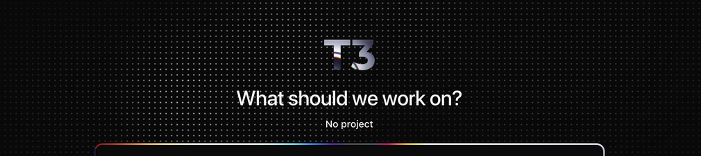
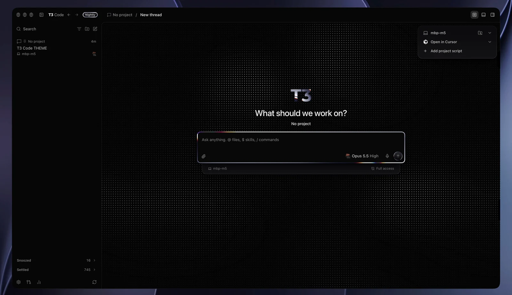
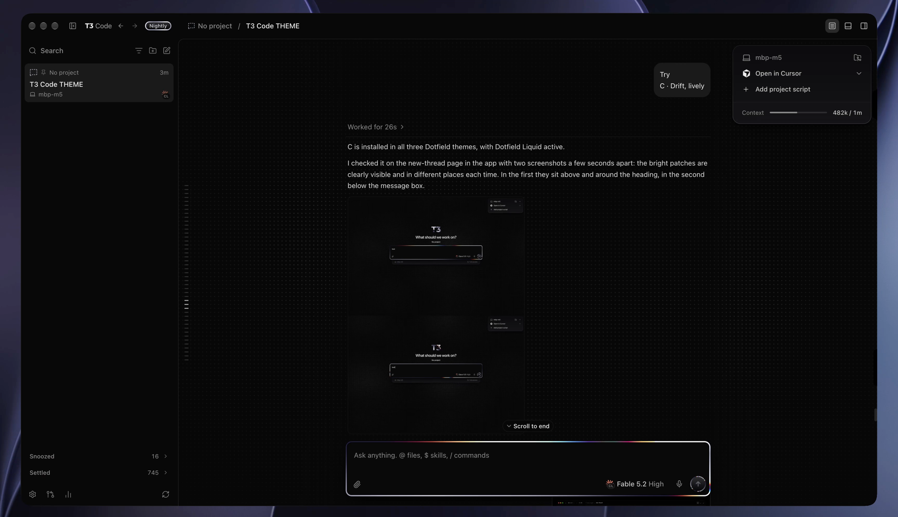

# Quicksilver

A dark theme for [T3 Code](https://t3.codes) with liquid metal edges. A wave of white-to-navy metal with a sharp rainbow front runs around the message box, the send button and the T3 logo. Behind it sits a quiet grid of dots.





## What it changes

- **Message box:** a solid near-black box with a liquid metal edge. A front is born on the bottom edge, runs both ways around the box and meets itself high on the right side. While the agent is working it passes once every 5 seconds; in an idle thread it slows to once every 15 seconds, so you can tell at a glance which threads are busy.
- **Send button:** a dark round button with the same metal as a ring.
- **New-thread page:** the T3 mark above the heading in the same metal, and soft patches of brighter dots that wander slowly over the grid.
- **Conversations:** the grid stands still, and it is dimmer behind the column of messages, so text stays easy to read.
- **Frame:** the sidebar, the top bar, the right panel and the terminal drawer are one dark frame. The chat sits in a panel set into it, with rounded corners where it meets them.
- **Under the message box:** the row with the computer, worktree, branch and access becomes a tab that hangs from the box.
- **Channel badge:** the "Nightly" badge becomes a small pill with a silver edge.
- **Buttons:** primary buttons, switches and sliders are bright silver with dark text. There is no colored accent.

## Install

```sh
curl -fsSL https://raw.githubusercontent.com/kristianbonnici/t3-quicksilver-theme/main/quicksilver.json -o quicksilver.json
t3 theme set quicksilver.json --id quicksilver
```

The second command adds the theme to T3 Code and makes it the active one. Run both again whenever you want the newest version. To leave Quicksilver, choose a different theme under Settings › Appearance.

### Install with an agent

You can also hand the job to an agent in T3 Code. Send it this:

> Please install the Quicksilver theme for me. The README at https://github.com/kristianbonnici/t3-quicksilver-theme has a "For agents" section with the steps.

### For agents

If you are an agent installing this theme:

- Fetch `quicksilver.json` from `https://raw.githubusercontent.com/kristianbonnici/t3-quicksilver-theme/main/quicksilver.json` and use it exactly as it is.
- With a shell, run `t3 theme set quicksilver.json --id quicksilver`.
- Without a shell, pass the file's contents to the `t3_theme_set` tool as `theme`, with `themeId` set to `quicksilver`.
- If the user wants the look changed, edit `theme.css` or `build.py` and rebuild. Don't edit the JSON by hand.

## Good to know

- Built and tested on the T3 Code Nightly builds from November 2026, in the desktop app on macOS. Earlier builds are untested.
- There is no light version.
- The moving metal is redrawn 60 times a second while the window is visible, which costs some processor time: on an M5 MacBook Pro, roughly a quarter to half of one core depending on the page, where T3's standard theme uses almost none when idle. Turning on your computer's Reduce Motion setting stops all motion and brings that back to the standard theme's level.
- Nothing behind the messages of a conversation moves, and the theme uses no live blur. Both made the app flicker while scrolling during development.
- The styles hook into the names T3 gives its page elements. When T3 renames or rearranges one of them, that part of the theme stops applying and you see T3's standard look there until the theme catches up.

## Make it your own

`theme.css` holds the styles. `build.py` holds the metal's colors and timing, fills them into `theme.css` and writes `quicksilver.json`. It needs only Python 3.9 or later.

```sh
python3 build.py
t3 theme set quicksilver.json --id quicksilver
```

Things to try in `build.py`: `CYCLE_SECONDS` for the wave's speed, `WAVE_COLORS` for the metal, `BOX_TIMING` for the path the front takes around the message box. In `theme.css`, `--qs-cell` sets the dot spacing and `--qs-dim` how much the dots dim behind messages.

## License

[MIT](LICENSE)
